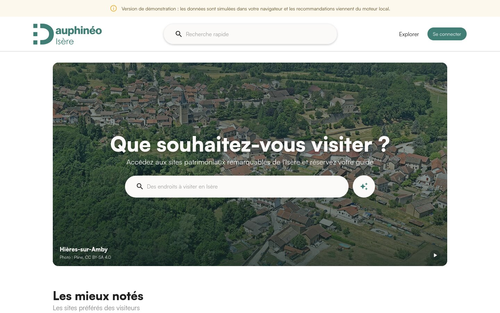

# SAÉ 3.01 – Dauphinéo (équipe 8)

Projet de deuxième année de BUT Informatique (IUT2 Grenoble, novembre 2024 à janvier 2025) : un site de réservation de
visites guidées dans les sites patrimoniaux remarquables (SPR) du Dauphiné. On y explore 46 communes de l'Isère, de la
Drôme et des Hautes-Alpes, on réserve un créneau avec un guide, on laisse un avis, et un questionnaire recommande les
sites qui correspondent à ses envies. On l'a appelé **Dauphinéo**, avec React pour le site et Laravel pour l'API.

La version rendue en janvier 2025 est marquée par le tag [`rendu-code`](https://github.com/aravenad/dauphineo/tree/rendu-code).
J'ai repris le projet seul en octobre 2026, après la fermeture des serveurs de l'IUT, pour brancher toutes les pages sur
l'API, sécuriser celle-ci et publier une démonstration sans serveur.

**Démonstration : [aravenad.github.io/dauphineo](https://aravenad.github.io/dauphineo/)**



## Ce qu'il y a dans le site

Chaque partie reprend un cas d'utilisation du dossier de conception (phase 2) :

- **Fiche d'un site** (UC3) : photos avec leur crédit, description, thèmes, carte, accessibilité PMR et créneaux à venir
- **Réservation** (UC2) : choix d'une date, d'un créneau et du nombre de personnes ; le prix est calculé par le serveur
  et les places restantes sont vérifiées
- **Avis** (UC4, UC5) : note de 1 à 5 et commentaire, un avis par site et par visiteur
- **Explorer** (UC6) : filtres par commune, thème, durée de visite et accessibilité PMR
- **Questionnaire** (UC7) : cinq questions (taille du groupe, thèmes, cadre, durée, PMR), puis jusqu'à six sites
  classés avec les réponses qu'ils satisfont ; Claude Haiku 5.5 rédige la raison de chaque site quand une clé d'API
  est configurée
- **Mon compte** : réservations à venir et passées, annulation, profil, mot de passe et suppression du compte

S'y ajoutent une recherche rapide dans l'en-tête, la FAQ, les mentions légales, la politique de confidentialité et les
CGU. Le site s'adapte aux écrans de téléphone et existe en français et en anglais : le bouton de l'en-tête change la
langue des pages, des descriptions des sites, des messages de l'API et des e-mails. Les pages légales restent en
français, seule version qui fait foi.

## Lancer le projet

### La démonstration

Elle tourne sans serveur : les données viennent des fichiers CSV du dépôt, et tout ce que vous faites (compte,
réservations, avis) reste dans votre navigateur. Les recommandations viennent du moteur local. Le bouton « Utiliser le
compte de démo » de la fenêtre de connexion remplit les identifiants. Pour la construire soi-même, il faut Node.js 24 :

```bash
cd frontend
npm install
npm run build -- --mode pages
npx vite preview --mode pages
```

### La version complète

Il faut PHP 8.2 ou plus récent avec l'extension `pdo_pgsql`, Composer, PostgreSQL 17 et Node.js 24. Pour l'API :

```bash
cd backend
composer install
cp .env.example .env
php artisan key:generate
```

Renseignez l'accès à PostgreSQL dans `.env` (`DB_DATABASE`, `DB_USERNAME`, `DB_PASSWORD`), créez la base, puis :

```bash
php artisan migrate --seed
php artisan serve
```

L'API répond sur `http://localhost:8000`. Le seeder importe les sites, les guides, les photos et les avis depuis
`backend/database/data/`, génère les créneaux des semaines à venir et crée des comptes de démonstration, dont
`demo@dauphineo.test`. Le site se lance ensuite à part et s'ouvre sur `http://localhost:5173` :

```bash
cd frontend
npm install
npm run dev
```

En local, les e-mails ne partent pas : `MAIL_MAILER=log` les écrit dans `backend/storage/logs/laravel.log`, où se
trouve le lien d'activation envoyé après une inscription. Les liens pointent vers `FRONTEND_URL`.

### La recommandation par Claude

Elle est facultative : le moteur local choisit et classe toujours les sites, Claude ne fait qu'en rédiger les raisons.
Sans clé, chaque site affiche la durée de visite et les réponses qu'il satisfait. Pour l'activer, créez une clé sur la [console Anthropic](https://console.anthropic.com/)
(l'abonnement Claude.ai ne couvre pas l'API ; pensez à fixer une limite de dépenses), puis ajoutez-la dans
`backend/.env` :

```dotenv
ANTHROPIC_API_KEY=votre-clé
ANTHROPIC_MODEL=claude-haiku-5-5
```

La clé reste côté serveur et n'est jamais envoyée au navigateur. Si l'appel échoue ou dépasse 15 secondes, l'API renvoie
les mêmes sites sans les raisons de Claude et l'indique dans sa réponse.

## Les autres commandes

| Commande | Rôle |
|---|---|
| `php artisan test` (dans `backend`) | Tests de l'API avec Pest, sur une base PostgreSQL `dauphineo_test` |
| `php artisan migrate:fresh --seed` (dans `backend`) | Remet la base à zéro avec les données de démonstration |
| `npm run lint` (dans `frontend`) | Analyse statique ESLint |
| `npm run build` (dans `frontend`) | Vérification des types et construction du site pour l'API locale |
| `npm run build -- --mode pages` (dans `frontend`) | Construction de la démonstration pour GitHub Pages |

Le workflow GitHub Actions lance les tests de l'API, l'analyse et la construction à chaque push sur `main`, puis publie
la démonstration.

## Arborescence

```
├── backend/                     l'API Laravel 12
│   ├── app/
│   │   ├── Http/Controllers/Api/    un contrôleur par ressource (sites, guides, avis, réservations, utilisateur…)
│   │   ├── Models/              Spr, Visite, Creneaux, Reservation, Avis, Guide, Utilisateur…
│   │   └── Services/
│   │       └── Recommandation/  le moteur local, l'appel à Claude et la lecture des réponses
│   ├── database/
│   │   ├── data/                les sites, guides, photos et avis en CSV
│   │   ├── migrations/
│   │   └── seeders/
│   ├── routes/api.php           les routes de l'API
│   └── tests/Feature/           les tests Pest, un fichier par ressource
├── frontend/                    le site React
│   └── src/
│       ├── api/                 le client HTTP et les types partagés avec l'API
│       ├── demo/                l'API simulée de la démonstration et sa copie du moteur local
│       ├── pages/               une page par route (accueil, explorer, fiche, compte, pages légales)
│       └── components/          en-tête, cartes, questionnaire, réservation, avis…
├── conception/                  nos dossiers de conception de 2024 (PDF)
└── docs/                        la capture d'écran de ce README
```

## Documents de conception

Nos rendus de l'automne 2024, tels quels :

- [Dossier de la phase 1](conception/dossier-phase1-team08.pdf) : cadrage, analyse de l'existant, risques, répartition
  des rôles et profils d'utilisateurs
- [Dossier de la phase 2](conception/dossier-phase2-team08.pdf) : besoins fonctionnels et cas d'utilisation, maquettes,
  architecture du code, schéma de la base de données et choix techniques

Le code a évolué depuis ces documents : les écarts sont listés plus bas.

## Nos choix

Le site React ne parle qu'à l'API Laravel, qui fait foi pour tout ce qui compte : le prix d'une réservation, les places
restantes, l'unicité d'un avis et la validation des réponses au questionnaire. L'authentification passe par des jetons
Sanctum. La démonstration remplace l'API par une version simulée dans le navigateur, qui lit les mêmes fichiers CSV que
le seeder, pour que les deux versions montrent les mêmes sites.

Le moteur de recommandation local existe en deux exemplaires, en PHP pour l'API et en TypeScript pour la démonstration.
Il est déterministe : la taille du groupe et l'accessibilité PMR écartent les sites qui ne conviennent pas, puis chaque
site gagne 3 points par thème choisi qu'il propose, 3 points si son cadre (ville, village, montagne) correspond et
jusqu'à 2 points selon l'écart à la durée voulue. À score égal, le site dont les thèmes recoupent le plus ceux du
visiteur passe devant, puis le plus petit identifiant. Quand Claude est configuré, il reçoit ces sites dans l'ordre et
ne rédige que leurs raisons, dans la langue du site ; seules celles des sites demandés sont gardées.

### Sécurité

- Les mots de passe sont hachés avec Argon2id et doivent compter 8 caractères, une majuscule, une minuscule, un chiffre et
  un caractère spécial, côté API comme côté formulaire.
- Les jetons Sanctum expirent au bout de 3 heures. Changer d'adresse e-mail ou de mot de passe et supprimer son compte
  redemandent le mot de passe actuel, et un nouveau mot de passe ferme les autres sessions.
- La connexion et l'inscription sont limitées à 10 essais par minute, les écritures d'un compte à 20 par minute.
- L'inscription répond la même chose qu'une adresse ait déjà un compte ou non. Le compte n'est créé qu'à l'ouverture
  du lien d'activation envoyé par e-mail, valable 24 heures, et une même adresse ne reçoit pas plus de 3 e-mails par
  heure. En démonstration, un bouton remplace l'e-mail.
- Chaque réservation et chaque avis ne peut être supprimé que par son auteur. Les places restantes sont décomptées par
  un déclencheur PostgreSQL, ce qui empêche deux réservations simultanées de dépasser la capacité d'une visite.
- Un compte ne peut pas avoir plus de 5 visites à venir, pour qu'une seule personne ne bloque pas tous les créneaux.
- Les erreurs de l'API sont rédigées en français (`backend/lang/fr`) et ne révèlent ni le nom des modèles ni le détail
  d'une erreur interne.
- L'API n'accepte que l'origine du site (CORS) et renvoie des en-têtes de sécurité (`nosniff`, `frame-ancestors 'none'`,
  HSTS en HTTPS). Le site publié embarque une politique de sécurité du contenu qui n'autorise que ses propres scripts.
- Les comptes inactifs depuis 3 ans sont supprimés automatiquement par une tâche planifiée.
- `composer audit` et `npm audit` ne signalent aucune faille dans les dépendances livrées, et Dependabot les tient à
  jour.

### Performance et animations

- Les photos viennent de Wikimedia Commons à la taille qui convient à l'écran (`srcset`) : chaque vignette de la page
  Explorer pèse environ 30 ko au lieu de 360 ko.
- L'accueil ne télécharge que son propre code ; les autres pages et le questionnaire arrivent à la demande.
- La police Satoshi est servie en WOFF2 (25 ko par graisse au lieu de 73 ko) et les deux graisses de l'accueil sont
  préchargées.
- Le site publié contient une copie de la page par route, pour que les liens partagés répondent 200 et non 404.
- Les animations (arrivée des pages, cartes en cascade, photos en fondu, barres de notes, en-tête qui se détache au
  défilement) n'animent que l'opacité et la position, et s'effacent quand le système demande moins de mouvement.

### Écarts avec le dossier de conception

| Dossier de conception | Réalisation | Raison |
|---|---|---|
| Recoil pour l'état global | Un contexte React pour la session | La session est la seule donnée partagée entre les pages |
| Paiement en ligne et facture par mail (UC2) | Réservation sans paiement | Pas de prestataire de paiement pour un projet de démonstration |
| Se proposer comme guide local (UC1) | Guides fournis par le seeder | Pas d'espace guide réalisé |
| Tableau de bord et disponibilités des guides (UC8, UC9) | Créneaux générés à partir des disponibilités du CSV | Même raison |
| Tables `FACTURE`, `LANGUE` et `SUIVI_DONNEES` | Absentes des migrations | Elles servaient au paiement, aux langues des guides et aux durées de conservation des données |

## Équipe

ARAVENA BRAVO Damien (chef de projet), JACOB Timothé, BENDRIS Nael, TIERRIE Axel, BENKHEIRA Lilya, DESCHAUX-BEAUME Maëlys, SEKMA Sarah.

## Crédits

- Sujet : SAÉ 3.01 du département Informatique de l'IUT2 Grenoble
- Site : React 19, TypeScript, Material UI 9, React Router 8, Axios et Vite 8 ; police Satoshi
- API : Laravel 12, Sanctum, Pest et PostgreSQL 17 ; SDK PHP d'Anthropic pour la recommandation
- Photos : les 217 photos des sites viennent de [Wikimedia Commons](https://commons.wikimedia.org/), sous licence libre
  (CC BY, CC BY-SA). Le fichier `backend/database/data/images.csv` garde pour chacune l'auteur, la licence et la page
  d'origine ; le site affiche le crédit sous chaque photo et la liste complète dans les mentions légales.
